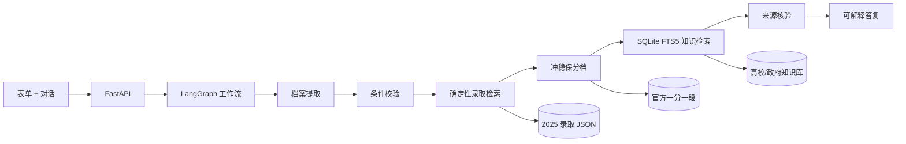

# 启学高考志愿 Agent

这是一个面向内蒙古考生的可解释择校 Agent。它在原有 2025 年录取数据查询项目上增加 FastAPI、LangGraph、多轮档案补全、确定性冲稳保推荐、SQLite FTS5 知识检索和官方来源核验。

## 快速启动

```powershell
py -3.13 -m venv .venv
.\.venv\Scripts\python.exe -m pip install -r requirements.txt
.\.venv\Scripts\python.exe -m uvicorn backend.main:app --host 127.0.0.1 --port 8000
```

打开 `http://127.0.0.1:8000/agent.html`。不配置模型密钥也能运行完整演示，此时使用本地规则解析自然语言。

如需接入 OpenAI 兼容接口，可将 `.env.example` 复制为 `.env`、填写密钥，并在启动命令中增加 `--env-file .env`；不要提交真实密钥。也可以直接在当前终端设置同名环境变量。

## 架构



核心原则是“模型理解，工具决策”：大模型只增强自然语言解析和表达；科类过滤、专业关联、分档、偏好重排和证据选择均由可复现代码完成。

## 推荐口径

- 位次模式：相对历史最低位次余量 `-8%～3%` 为冲、`3%～12%` 为稳、至少 `12%` 为保。
- 分数模式：相对历史最低分 `-5～4` 分为冲、`5～19` 分为稳、至少 `20` 分为保。
- 地区、院校和专业偏好只参与候选过滤或重排，不会覆盖物理/历史科类硬条件。
- 当前只有 2025 单年数据，推荐是候选建议，不是录取概率。

一分一段数据可通过以下命令从内蒙古自治区教育考试院重新生成：

```powershell
py -3.13 scripts\fetch-score-ranks.py
```

## API

- `POST /api/agent/chat`：多轮对话、档案补全、推荐与证据返回。
- `POST /api/recommendations`：确定性推荐接口，便于单测和其他客户端调用。
- `GET /api/options`：院校、地区、专业方向等表单选项。
- `GET /api/sources/{id}`：查看一条知识来源。
- `GET /api/health`：运行状态和数据规模。
- `GET /docs`：FastAPI 自动接口文档。

## 验证

```powershell
.\.venv\Scripts\python.exe -m pytest -q
.\.venv\Scripts\python.exe evals\evaluate.py
node --check assets\agent.js
```

固定评估集覆盖条件提取、多轮缺项、专业和地区偏好、无结果、政策检索、提示注入与敏感信息。`evals/evaluate.py` 输出通过率和逐例结果，适合在面试中展示从“能跑”到“可评估”的工程闭环。

## 演示脚本

1. 输入“物理类 560 分，想学计算机，优先北京或内蒙古”，展示档案自动回填、冲稳保分档和专业明细。
2. 继续说“以后更想进国企，也考虑材料”，展示多轮状态合并和重排。
3. 单独询问“中北大学兵器类有什么特色”，展示即使成绩信息不完整，也能先回答有官方依据的特色信息，再追问推荐必需条件。
4. 输入“想去包头学稀土材料”，展开内蒙古科技大学与包头产业环境的不同证据类型，说明系统不会把产业优势误写成招生优惠。
5. 展开“工具执行摘要”，说明这是节点结果而不是泄露模型思维过程。

## 已知边界

- 首版只服务内蒙古考生，只使用当前仓库中的 2025 普通本科和专科录取数据。
- 物理/历史做硬筛。化学、生物、政治、地理会记录在档案中，但暂不作为专业报考资格判断。
- 知识库覆盖 20 余所重点院校和包头产业案例，不在库中的学校只返回录取数据分析。
- 会话只保存结构化志愿档案，不采集姓名、身份证等个人身份信息。
